# Tangle

A small first-person game about strange loops, the idea at the heart of Douglas Hofstadter's
*Gödel, Escher, Bach*, for players who have never read the book. Each room is one kind of loop,
built as a puzzle that you solve by understanding it. When you solve one, a short debrief
appears in place.

<!-- darkroom:shot triangle-closes -->
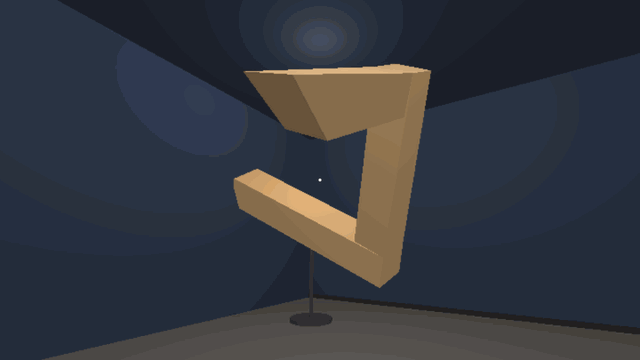

*Walk to the one viewpoint and the triangle closes.*

[MP4 version](docs/media/triangle-closes.mp4)
<!-- darkroom:end -->

**Status: complete.** It has a hub and six rooms:

- **The Triangle (Escher).** A real impossible triangle stands in the room. From almost everywhere
  it is visibly an open, bent bar. Find the one spot where it closes. When you walk away, it
  breaks again.
- **The Machine (Gödel).** The MIU puzzle as a console with four rule buttons: turn `MI` into `MU`.
  You can't. After a while a gate opens and you can climb to a balcony, outside the machine, where
  a board counts the I's in every word you made. Only from up there can you see why `MU` is
  impossible.

- **The Screen (self-reference).** A big screen shows exactly what you see, turned a little. Walk up
  and look straight at it, and it fills with copies of itself, spiralling down. Once you've seen it
  many levels deep, a lectern wakes up with sentences that talk about themselves ("This sentence has
  five words."), which you sort into true and false. The last one is "This sentence is false." Both
  answers lead to a contradiction, and only then does a third button light: *can't be either*. The
  debrief explains how Gödel's "This sentence can't be proved" differs: it isn't a paradox, it's true
  and unprovable.

- **The Staircase (Bach, Escher).** Six flights around an open well, each one whole tone higher: the
  landings are C, D, E, F♯, G♯ and A♯. The flight past A♯ climbs back to C, at the door you came in,
  and the stairs carry on. You can climb forever: a readout says how far above the door you are,
  footsteps play Shepard tones that rise endlessly, and the stairs repeat above and below. Outside
  the stairs, in the vestibule, the wall asks: where is the top?

- **The List (Cantor, Gödel).** A library. The librarian's list claims to hold every endless row of
  light and dark tiles: it goes on forever, and so does each row. Set eight switches to start a row
  and press CHECK. Whatever you try, the librarian finds a row further down that starts the same way,
  and you can't check forever. The way out is the diagonal: make tile 1 the opposite of row 1's
  tile 1, tile 2 the opposite of row 2's tile 2, and so on. That row differs from every row
  somewhere. The librarian adds your row to the top of the list, and you beat it again the same way.
  Then the wall asks which list could hold every row. The debrief connects it to Cantor's bigger
  infinities, Gödel's "I am not provable" and Turing's halting problem.

- **The Prover (Gödel).** The last room, behind a door the List opens. The Prover tries every proof,
  shortest first, and it is honest: it never proves anything false. Feed it `2 + 2 = 4` and it stamps
  the card PROVED; feed it `2 + 2 = 5` and it searches forever. Every card has a number, so card 81,
  "The Prover can't prove card __", can be set to talk about itself. Fed in, it runs forever too, and
  a lectern asks why: if the Prover proved card 81 it would have proved something false, so it never
  does, and that is exactly what card 81 says. It's true, and it can't be proved. A closing card
  gathers every room's loop into Hofstadter's idea that "I" is a strange loop.

## Pictures

Every picture here is the real game, shot by [darkroom](https://github.com/Preponderous-Software/darkroom) from `media.json` (serve the game on port 8781, then `darkroom shoot media.json`).

<!-- darkroom:start -->
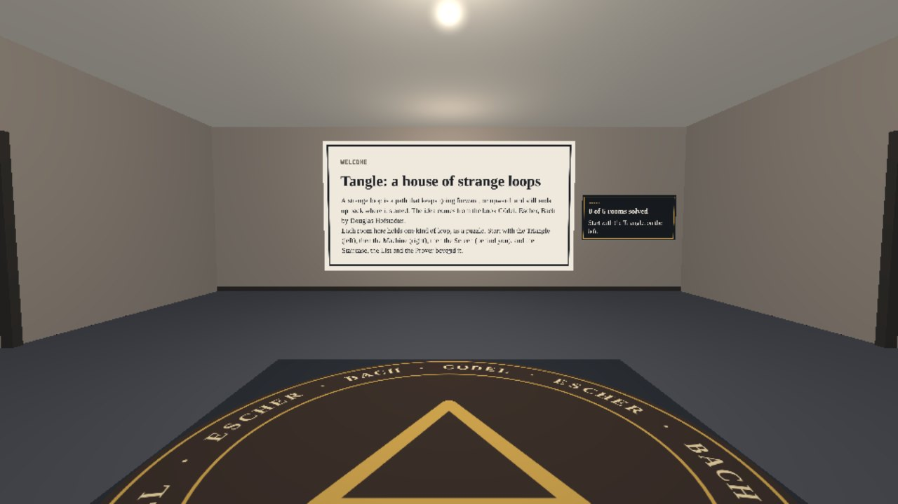

*The hall: every door leads to a strange loop.*

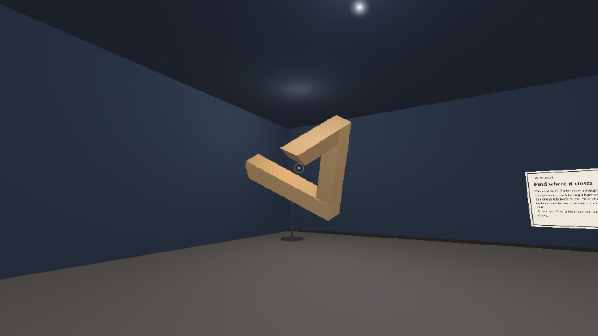

*The Triangle from the wrong place: a bent, open bar.*


*Walk to the one viewpoint and the triangle closes.*

[MP4 version](docs/media/triangle-closes.mp4)

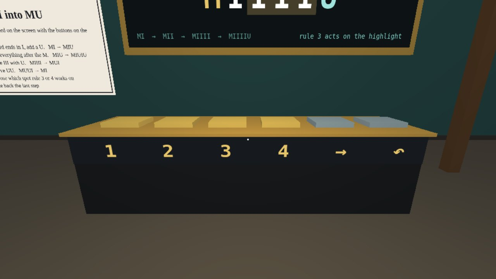

*The Machine: turn MI into MU with four rules. You can't, and the balcony shows why.*

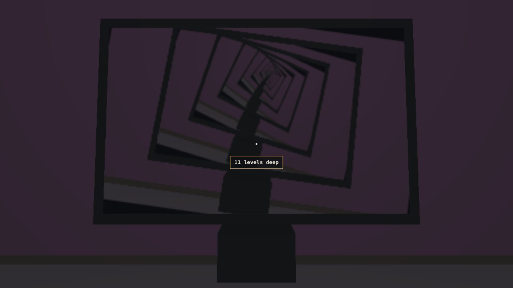

*The Screen: a screen that shows whatever you see, so it shows itself.*

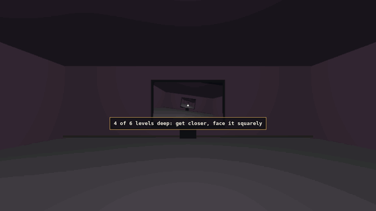

*Walking up to the screen: it fills with copies of itself.*

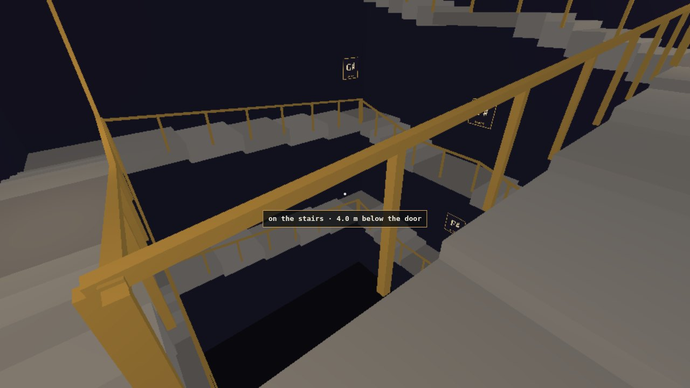

*The stairwell: six flights, each a whole tone higher, and it never ends.*

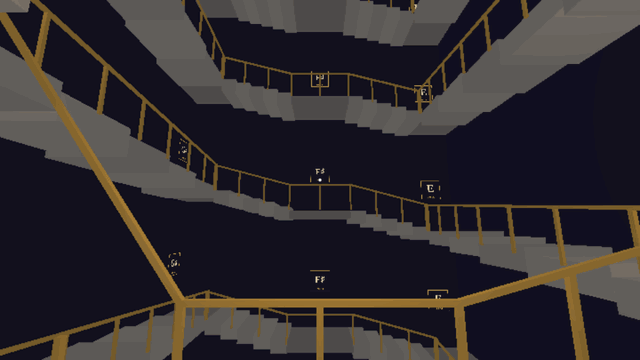

*Climbing the stairs: one whole loop, back past the door, and the height readout keeps climbing.*

[MP4 version](docs/media/stairs-forever.mp4)

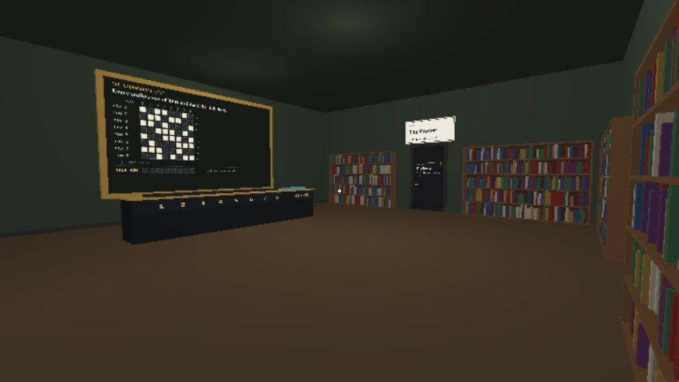

*The List: a library, and a list that claims to hold every endless row.*

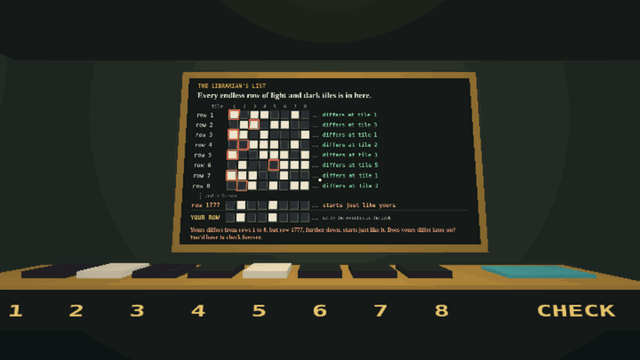

*The List: flip each tile on the gold diagonal, and your row differs from every row in the list.*

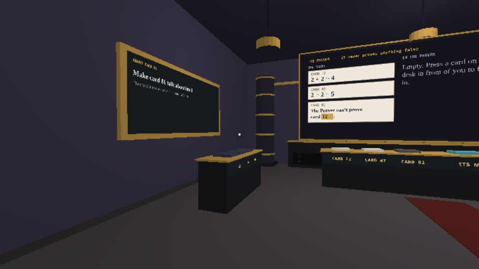

*The Prover, the last room: a machine that tries every proof.*

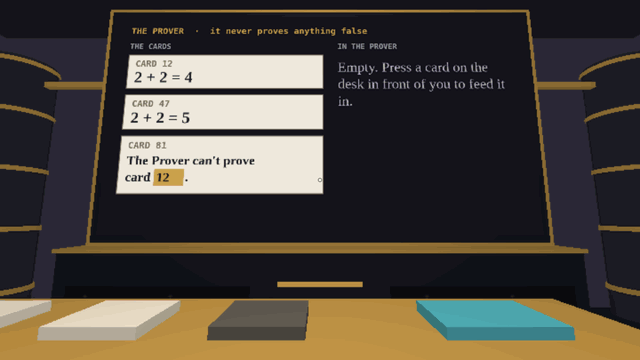

*The Prover proves 2 + 2 = 4, searches forever for 2 + 2 = 5, then meets card 81: “The Prover can't prove card 81.”*

[MP4 version](docs/media/prover.mp4)

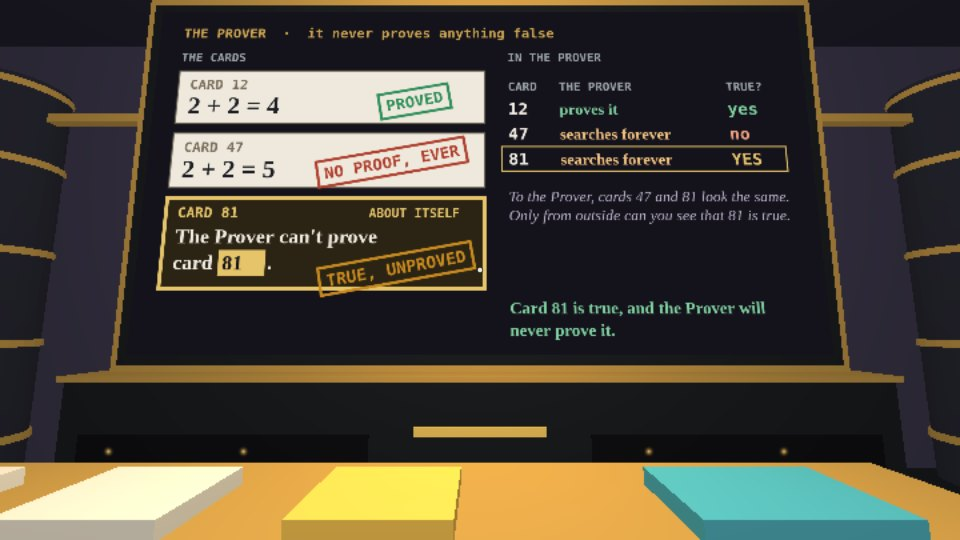

*Solved: to the Prover, cards 47 and 81 look the same. Only from outside can you see that 81 is true.*

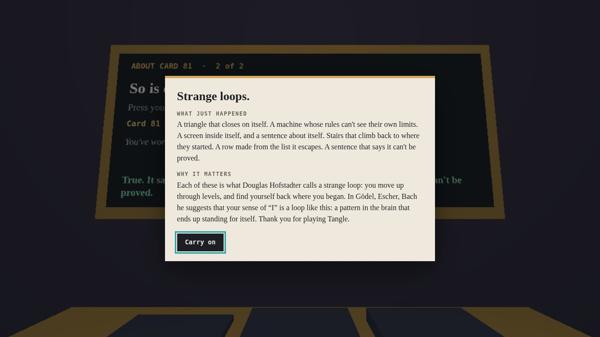

*The closing card, once every room is solved.*
<!-- darkroom:end -->

## Play

**In a browser: [tangle.play.danielstephenson.dev](https://tangle.play.danielstephenson.dev)**, on a computer or a phone. Every push to `main` that passes the tests redeploys it there.

On Windows with WSL, `tools/play-tangle.bat` copies the game from WSL (set `TG_SRC` to point elsewhere),
serves it locally and opens it in its own Edge app window. Options: `fullscreen`, `new` (start over), `browser`.

From WSL or Linux:

```sh
python3 -m http.server 8781 --bind 127.0.0.1   # then open http://127.0.0.1:8781/
```

A title card teaches the controls:

- **Keyboard and mouse:** W A S D to walk (Shift to run), the mouse to look, E or a click to use
  things, Esc to pause.
- **Keyboard only:** the arrow keys turn and PageUp/PageDown look up and down. At any desk or lectern,
  the number keys 1–9 press its buttons in label order, and Enter presses the List's CHECK.
- **Touch:** the stick walks, dragging looks around, the Use button (or a tap) presses things, and
  ≡ pauses.

The pause menu has look speed, invert, field of view, text size, sound and Start over. Progress
and your position are saved, and Continue puts you back where you were. The camera never turns by
itself.

## What it feels like

- **Teaching:** captions narrate in plain words, one idea at a time. A NEXT line always says what
  to do. Each solve ends with a short debrief: what just happened, and why it matters.
- **The Triangle:** a tone (and the crosshair ring) warms as you near the one viewpoint. Hold still
  there and a ring fills. Then you're asked to step aside and watch the triangle break. After 70
  seconds a ring of light marks the spot.
- **The Machine:**
  - The screen shows the word, the last few steps, and why a press didn't work.
  - Aiming at a button previews what it would do (`MI → MIU`).
  - The balcony board stays covered until you climb up to it.
- **The Screen:**
  - The screen is live video feedback. Each frame is read back from the canvas, turned slightly and
    uploaded as the screen's texture.
  - A readout counts how many copies you can see ("4 of 6 levels deep"). It asks you to step back
    if you're too close.
  - The target is 6 levels in landscape and 4 on a portrait phone, where the copies shrink faster.
  - Wrong answers at the lectern explain why.
- **The Staircase:**
  - Every floor exists in three copies, a loop's height apart.
  - Each time you pass C, the game quietly moves you down (or up) one loop. The geometry repeats, so
    the view doesn't change.
  - It counts the loops, so the height readout keeps climbing.
- **Sound:** all synthesized: footsteps, a quiet tone for each room, button clicks, and chords when
  you solve something.

## How it's built

- **Engine.** [Strata](https://github.com/Preponderous-Software/strata) through its web kit. Tangle's
  own small host, `engine/host.cpp`, keeps textures and meshes by slot plus lists of primitives, glow
  points and lights, and draws in first person. `engine/build.sh` builds it against Strata's public
  v0.7.0 wasm release (SHA-256 checked, emsdk 6.0.11) into `engine/tangle-engine.{js,wasm}`, and
  copies the kit's page scripts beside it. The outputs are committed, so playing needs no build step.
  The page builds every mesh and texture in JavaScript and hands them over once, then moves the eye
  each frame.
- **Code.**
  - `src/walk.js`: walking, collision, floors and the ramp. Pure, with node tests.
  - `src/miu.js`: the MIU rules.
  - `src/sentences.js`: Room 3's sentences, with checks that each answer is true of itself.
  - `src/diagonal.js`: Room 5's list, the diagonal and the librarian's answers.
  - `src/prover.js`: Room 6's cards, what the Prover does with each, and the questions about card 81.
  - `src/probe.js`: the playtester probe (only with `?probe`).
  - `src/tribar.js`: the tribar construction.
  - `src/world.js`: the house layout.
  - `src/text.js`: plaques drawn on a canvas.
  - `src/game.js`: the page.
- **How the tribar works.** It is built nearly orthographically: three bars along x, y and z, with
  their free ends offset along (1,1,1). One bar is cut exactly by the other's silhouette prism.
  Then every vertex is slid along its own line of sight from the viewpoint, which is a projective
  warp. From that viewpoint the perspective image is exactly the orthographic one, so the triangle
  closes seamlessly. From anywhere else it is visibly broken and tapered, like real tribar
  sculptures.
- **Checks.** Run `npm install && npx playwright install chromium` once for the two browser tools, with the game served on port 8781.
  - `npm test` (node) covers the tribar's alignment and normals, the MIU invariant, walking, and
    every route through the house.
  - `npm run shots` drives the game frame by frame
    (`?drive=1`), screenshots fixed poses (and the title card, and a player's first seconds) into
    `shots/`, and fails on any console error, including a mesh the engine refuses.
  - `npm run playthrough` plays the whole slice
    through the real inputs: W to walk, turning toward each waypoint, E to press what the
    crosshair is on. It exits non-zero unless every room ends solved with no errors.
- **Pictures.** `media.json` is a [darkroom](https://github.com/Preponderous-Software/darkroom) shot list: the stills
  and GIFs in this README, driven frame by frame (`?drive=1`, `?skip=4`, `?skip=5`). `darkroom gallery media.json --insert README.md`
  refreshes the gallery.
- **AI playtests.** `tools/playtest/tangle.json` is a profile for
  [playtester](https://github.com/Preponderous-Software/playtester): AI agents play the real game in
  headless Chromium windows (`tools/playtest-launch.sh`), steered by a probe the page writes with
  `?probe` (`src/probe.js`, through `tools/serve.py --probe-dir`). Run
  `pt smoke --profile tools/playtest/tangle.json --game-dir .`; the evidence from each run goes in
  `docs/playtests/<version>/`.

## Related

- [Coastline](https://coastline.play.danielstephenson.dev)
  ([repo](https://github.com/Preponderous-Software/coastline)): a companion game about fractals, covering
  the coastline paradox, the Koch snowflake and fractal dimension. Tangle covers self-reference and
  strange loops; Coastline covers self-similarity and how to measure it.
- [Strata](https://github.com/Preponderous-Software/strata): the engine.

## License

The code is MIT licensed (see [LICENSE](LICENSE)). The art the game draws (plaques, renders, the loading poster) is CC0.
